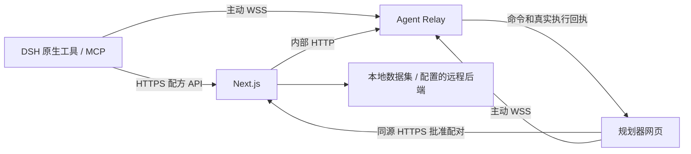

# 公网 Agent 中转

DSH 原生插件和通用 MCP 共用工具、数据客户端、连接工厂和中转协议。
用户配置你部署的网页地址，在网页中批准工程，即可让 agent 查询配方、编辑和验证产线。
两端都主动连接服务器的 HTTPS/WSS 443，客户端无需监听端口、端口映射或 NAT 穿透。



## 部署

这是与 Live 协作服务独立的进程。现有 Live 端口、账号权限、租约和保存协议不变。
以下为部署模板；本次开发不会部署服务器，也不会修改线上配置。

1. 在服务器安装项目依赖并构建：

   ```sh
   npm ci
   npm run build
   npm run build:agent-relay
   ```

2. Next.js 进程设置：

   ```dotenv
   AGENT_RELAY_INTERNAL_URL=http://127.0.0.1:3002
   AGENT_RELAY_PROXY_TOKEN=<与 relay 相同的随机密钥>
   ```

   配方来源继续由网站的 `GTNH_DATASET_BACKEND_URL` 或本地数据集配置决定。
   Agent 永远访问所配置网站的 `/api/datasets/...`，不会直接打开配方文件。

3. 独立运行 relay。systemd 示例 `/etc/systemd/system/gtnh-agent-relay.service`：

   ```ini
   [Unit]
   Description=GTNH agent relay
   After=network.target

   [Service]
   Type=simple
   User=gtnh
   WorkingDirectory=/opt/gtnh-flow/current
   EnvironmentFile=/opt/shared/agent-relay.env
   ExecStart=/usr/bin/node dist-agent-relay/main.mjs
   Restart=on-failure
   RestartSec=3
   NoNewPrivileges=true

   [Install]
   WantedBy=multi-user.target
   ```

   `WorkingDirectory` 和 `User` 应替换为你的真实部署目录和运行用户。
   `/opt/shared/agent-relay.env`：

   ```dotenv
   AGENT_PUBLIC_ORIGIN=https://planner.example.com
   AGENT_RELAY_HOST=127.0.0.1
   AGENT_RELAY_PORT=3002
   AGENT_RELAY_MAX_ROOMS=100
   AGENT_RELAY_PROXY_TOKEN=<与 Next.js 相同的随机密钥>
   ```

   用 `openssl rand -hex 32` 生成密钥，文件只允许运行用户读取。
   relay 内部健康检查：`curl http://127.0.0.1:3002/health`。

4. Caddy 只在公网暴露网站的 443。将下面的路由并入已有网站配置：

   ```caddyfile
   planner.example.com {
     @agent_ws path /agent/ws
     handle @agent_ws {
       reverse_proxy 127.0.0.1:3002 {
         header_up X-Agent-Proxy-Token "<与 relay 相同的随机密钥>"
         header_up X-Agent-Client-Ip {client_ip}
       }
     }
     handle {
       reverse_proxy 127.0.0.1:3000 {
         header_up X-Client-Ip {client_ip}
       }
     }
   }
   ```

   在 Caddy 前使用 Cloudflare 等代理时，应按可信代理 IP 范围配置真实客户端地址。
   必须由可信反代覆盖 IP 头，不要把用户自己提交的头当成真实地址。
   不要记录配对 POST 请求体、Authorization 或 WebSocket 帧；关闭这些路径的缓存。
   多实例部署需要把同一站点的配对 HTTP 和 WSS 固定到同一个 relay；当前状态保存在内存，尚不支持跨实例共享。

未设置 `AGENT_RELAY_INTERNAL_URL` 时，相关 API 明确返回 503，原网页和本地桥接继续可用。
Next.js 的开发服务器不会替代 WSS 反代；本地测试完整中转可运行下面的验收脚本，或用同样的 Caddy 路由。

## 用户安装与配对

DSH：安装 `dist-dsh/dsh-gtnh-planner-0.2.0.tgz`，在已有插件配置项设置：

```yaml
- id: gtnh-planner
  config:
    plannerUrl: https://planner.example.com
    connectionMode: auto
```

这是插件本身的配置，不需要另外安装 MCP 或 skill。修改配置后重载插件并重新配对。

通用 MCP：运行 `npm run build:mcp` 后，在客户端配置 stdio 服务：

```json
{
  "mcpServers": {
    "gtnh": {
      "command": "node",
      "args": ["/absolute/path/gtnh-factory-flow/dist-mcp/main.mjs"],
      "env": {
        "GTNH_PLANNER_URL": "https://planner.example.com",
        "GTNH_AGENT_TRANSPORT": "auto"
      }
    }
  }
}
```

同时安装仓库中的 `skills/gtnh-production-planner`，更新后重新复制到客户端技能目录。
MCP 进程仍在用户机器上运行；它以 stdio 接入 agent，以 HTTPS/WSS 出站访问网站。

`auto` 在 HTTP 回环地址使用兼容的本地桥接；HTTPS 使用 relay。
`relay` 可以在 HTTP 回环地址强制使用中转，方便测试；公网必须 HTTPS。
`local` 只能用于回环地址。配置错误不会静默切换数据来源或传输模式。
兼容的旧式本地配对仍授权整个浏览器会话，包含新建设计；网页会明确显示这一范围。
需要按工程授权时，即使在回环地址也应选择 `relay`。

1. Agent 调用 `begin_pairing`（DSH 名称为 `gtnh_begin_pairing`），用户打开返回的网站地址。
2. 打开可编辑的工程，在 Settings > Agent 粘贴配对码。需要新建工程时，勾选 **Allow new designs in this session**。
3. 点击 Connect。默认只授权当前工程，`list_designs` 不会枚举其他工程。
4. 保持网页打开。网页负责规范配方加载、原子编辑、求解和 IndexedDB 保存；服务器只转发命令和执行回执。
5. 点击 Disconnect 撤销两端授权。手动切换到未授权工程也会撤销连接。

## 授权、断线与当前边界

- 配对码十分钟有效且只可批准一次，包含随机 60 位用户码，不包含 agent 私有凭据。
- 授权绑定浏览器会话、工程 ID 和新建权限，最长十二小时，最多一百个工程。私有凭据仅保存在运行内存中。
- 浏览器和 agent 的凭据不可互换；浏览器必须匹配网站 Origin。公共服务限制房间数、请求频率、帧大小和并发命令数，并清理失效连接。
- 短暂断线自动重连同一授权，不自动重放写入。取消、超时或断线可能发生在编辑已提交之后，必须先读取工程再继续。
- 最近的写入 requestId 有有界回执缓存。只可对完全相同的命令复用 ID，不要把缓存当成永久的事务日志。
- 重启 relay、关闭网页后重新打开、刷新网页或过期后需要重新配对。没有网页时不能后台求解或编辑。
- 当前支持浏览器本地保存的普通工程，线上部署不代表工程已经存入服务器。云端/Live 工程仍拒绝代理编辑，账号同步和协作租约不被绕过。
- 此版本没有跨用户工程分享、无人值守授权或服务器后台求解，也不会远程控制 Minecraft。

## 验证

```sh
npm run typecheck
npm test
npm run build:mcp
npm run build:dsh
npm run build:agent-relay
npm run build
npm run test:agent:relay:browser
npm run test:dsh:relay:browser
```

浏览器验收使用真正的 Next.js、独立 relay、同源反代、headless Chromium 和人工配方夹具。
同一验收分别通过真实 stdio MCP 客户端与实际安装包中的 DSH 原生 SDK 工具执行，覆盖配对、编辑、求解、撤销、排列、保存及数据版本冲突。
还会分别切断浏览器与 agent 的连接，检查重连、离线手动编辑的版本保护、默认禁止新建及切换到未授权工程后的撤销。
报告位于 `scratch/agent-relay-browser/` 和 `scratch/dsh-relay-browser/`。
这些测试不调用大模型，也不证明具体 GTNH 生存配方正确；公网 TLS、Cloudflare 和真实服务器部署应在部署后另行验收。
